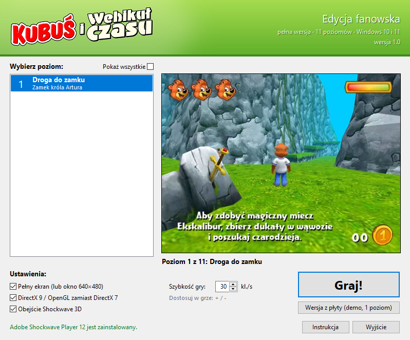
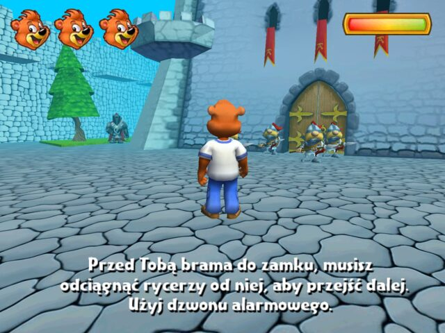
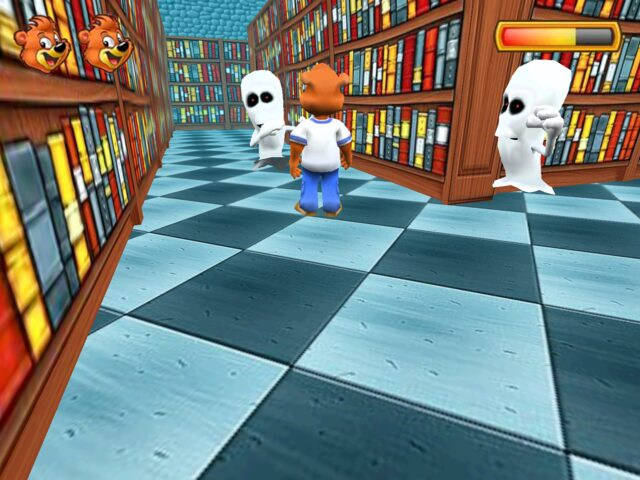
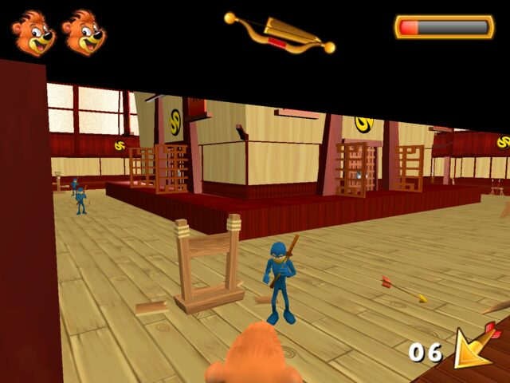
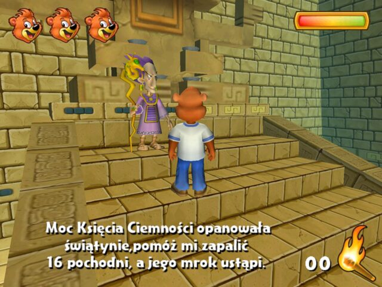
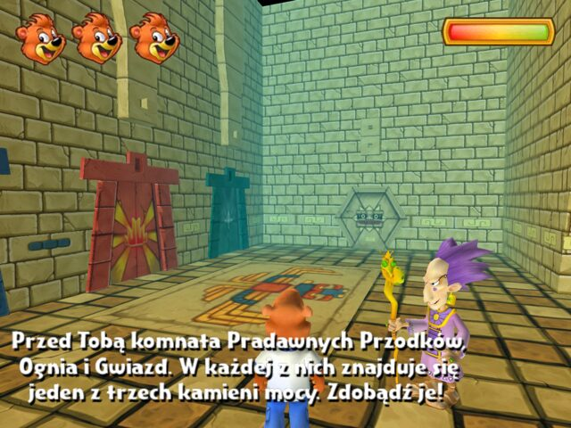
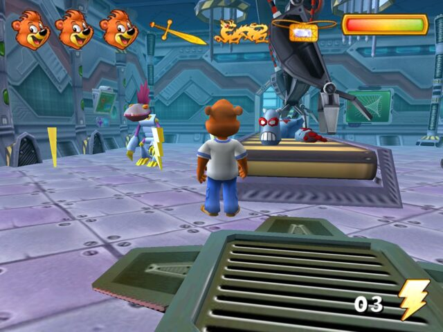
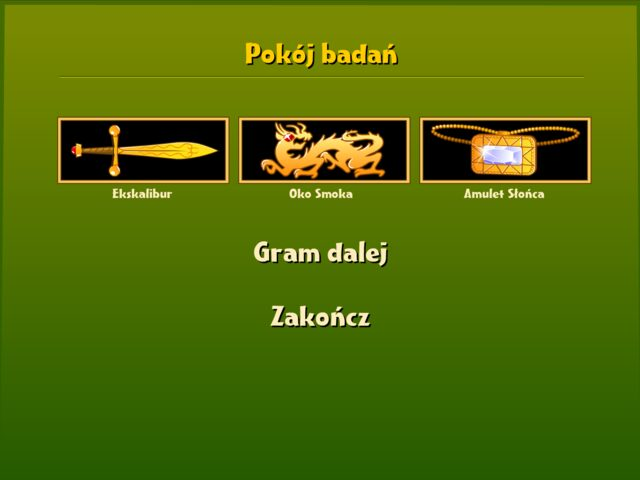

# Kubuś i Wehikuł Czasu – edycja fanowska

  

**Kubuś i Wehikuł Czasu (2005)** to polska zręcznościowo - przygodowa gra 3D, wydana na płycie CD (wersja demo z jednym poziomem) dołączanej do wielopaków soków Kubuś,
gdzie kolejne etapy pobierało się ze strony kubus.pl. Strona już nie działa, a gra na współczesnym
Windowsie działała za szybko (Kubuś teleportował się po ekranie), zmieniała rozdzielczość monitora i nie dało się
przejść do kolejnego poziomu.

To repozytorium zbiera **pełną wersję (11 poziomów)** w jednym miejscu, poprawia ją tak, żeby
dało się w nią normalnie zagrać, i pakuje ją w instalator z wygodnym launcherem.

**[⬇ Pobierz najnowsze wydanie](https://github.com/HayyardenStudio/Kubus-i-Wehikul-Czasu-Edycja-fanowska/releases/latest)** – instalator albo wersja przenośna (ZIP).

Strona gry: **[hayyardenstudio.github.io/Kubus-i-Wehikul-Czasu-Edycja-fanowska](https://hayyardenstudio.github.io/Kubus-i-Wehikul-Czasu-Edycja-fanowska/)**

**[▶ Zagraj w przeglądarce](https://hayyardenstudio.github.io/Kubus-i-Wehikul-Czasu-Edycja-fanowska/gra/)** – wszystkie 11 poziomów na three.js, bez instalowania.

> To nieoficjalny, niekomercyjny projekt fanów. Szczegóły w sekcji [Informacja prawna](#informacja-prawna).

Bazą dla tej edycji fanowskiej jest pełna wersja gry zachowana w Internet Archive:
[Kubuś i Wehikuł Czasu – pełna wersja + demo](https://archive.org/details/kubus-i-wehiku-czasu-pl-pelna-wersja-demo-winnie-and-the-time-machine-full-version-demo.w)

---

## Spis treści

- [O grze](#o-grze)
- [Jak zagrać](#jak-zagrać)
- [Sterowanie](#sterowanie)
- [Gdy coś nie działa](#gdy-coś-nie-działa)
- [Co zostało poprawione](#co-zostało-poprawione)
- [Zrzuty ekranu](#zrzuty-ekranu)
- [Stan testów](#stan-testów)
- [Informacja prawna](#informacja-prawna)
- [English summary](#english-summary)

## O grze

Kubuś wsiada do wehikułu czasu i odwiedza cztery światy, zbierając po drodze magiczne
przedmioty: miecz Ekskalibur, Oko Smoka i Amulet Słońca.

| Świat | Poziomy |
|---|---|
| Zamek króla Artura | 1. Droga do zamku · 2. Duży dziedziniec · 3. Mały dziedziniec · 4. Zamek króla Artura |
| Kraina samurajów | 5. Dziedziniec pałacu szoguna · 6. Pałac szoguna · 7. Komnata szoguna |
| Świątynia słońca | 8. Hol świątyni · 9. Trzy próby |
| Miasto przyszłości | 10. Hol laboratorium · 11. Pokój badań |

## Jak zagrać

Wymagania: Windows 10 lub 11, karta graficzna z obsługą 3D.

### W przeglądarce (poziomy 1–11)

Na [stronie gry](https://hayyardenstudio.github.io/Kubus-i-Wehikul-Czasu-Edycja-fanowska/gra/) można
zagrać we wszystkie 11 poziomów bez instalowania czegokolwiek: **Droga do zamku**, **Duży dziedziniec**, **Mały dziedziniec**, **Zamek króla Artura**, **Dziedziniec pałacu szoguna**, **Pałac szoguna**, **Komnata szoguna**, **Hol świątyni**, **Trzy próby**, **Hol laboratorium** i **Pokój badań**. Gra działa na three.js. Modele,
tekstury i dźwięki pochodzą z oryginału, a skrypty Lingo zostały przepisane na JavaScript.
Potrzebny jest komputer z klawiaturą i aktualna przeglądarka z obsługą WebGL.
Poziom wybiera się przed startem; po ukończeniu każdego z pierwszych dziesięciu przycisk „Gram dalej” prowadzi do następnego.
Selektor nad grą pokazuje domyślnie tylko odblokowane etapy. Wygrana odblokowuje kolejny,
a postęp zapisuje się w przeglądarce. Checkbox „Pokaż nieodblokowane poziomy” odsłania pozostałe etapy i pozwala je wybrać.
Na Dużym dziedzińcu **Ctrl** służy do naprawy dźwigni u kowala oraz montażu i użycia mechanizmu bramy.
Na Małym dziedzińcu **Ctrl** uruchamia dzwon odciągający strażników oraz otwiera drzwi do zamku.
W Zamku króla Artura **Ctrl** otwiera skrzynie i uruchamia dźwignię czasowej kraty.
Na Dziedzińcu pałacu szoguna zbierz 50 kryształów i podejdź do smoka, aby otworzyć bramę pałacu. **Ctrl** otwiera przesuwane drzwi.
W Pałacu szoguna **Ctrl** otwiera 30 przesuwanych drzwi i 11 skrzyń. Odszukaj łuk i kołczan, aby otworzyć drzwi do komnaty szoguna.
W Komnacie szoguna zbierz 20 strzał, wręcz łuk szogunowi i otwórz szkatułkę klawiszem **Ctrl**. Oko Smoka uruchamia portal.
W Holu świątyni zapal 16 pochodni klawiszem **Ctrl**, wróć do kapłana i przejdź przez końcowe drzwi. Uważaj na węże i pułapki strzelające.
W Trzech próbach zdobądź trzy kamienie mocy, wróć do kapłana i uruchom trzy ołtarze klawiszem **Ctrl**.
Zabierz zwierciadło, ustaw je u królowej i zdobądź Amulet Słońca, który otwiera portal.
W Holu laboratorium zbierz 35 ogniw energetycznych i uruchom konsolę klawiszem **Ctrl**, aby otworzyć pokój badań.
W Pokoju badań umieść Ekskalibur, Oko Smoka i Amulet Słońca w trzech schowkach klawiszem **Ctrl**.
Komplet uruchamia komputer i zatrzymuje wojowników. Wróć do wynalazcy, aby zakończyć przygodę.
Po finale pojawia się oryginalna plansza z Kubusiem, robotami i opowieścią o powrocie do naszych czasów.
Szczegóły techniczne: [`tools/w3d_eksport/README.md`](tools/w3d_eksport/README.md).

### Instalator (polecany)

1. Pobierz i wypakuj paczkę `Kubus-i-Wehikul-Czasu-1.0.zip` z
   [Releases](https://github.com/HayyardenStudio/Kubus-i-Wehikul-Czasu-Edycja-fanowska/releases/latest) i uruchom `Kubus-i-Wehikul-Czasu-<wersja>-instalator.exe`.
2. Plik .exe nie jest sygnowany, dlatego najpewniej uruchomi się Windows Defender SmartScreen - wybierz `Więcej informacji` i `Uruchom mimo to`.
3. Zostaw zaznaczony **Adobe Shockwave Player 12.3**, jeśli nie jest u Ciebie zainstalowany. Instalator dołącza instalator Adobe.
4. Uruchom grę skrótem „Kubuś i Wehikuł Czasu”, wybierz poziom i kliknij **Graj!**

Instalator dodaje skróty w Menu Start i na pulpicie oraz wpis w „Aplikacje i funkcje”, więc grę
można normalnie odinstalować. Shockwave Player zostaje wtedy w systemie, bo mogą go używać inne gry.

### Wersja przenośna (ZIP)

1. Pobierz `Kubus-i-Wehikul-Czasu-<wersja>.zip` i rozpakuj go w dowolnym miejscu.
2. Uruchom `Kubus.exe`.
3. Jeśli na dole okna widać „Brak Adobe Shockwave Player 12”, kliknij **Zainstaluj Shockwave 12**.

### Prosto z repozytorium

Pobierz repozytorium (Code → Download ZIP) i uruchom `pelna_wersja/Kubus.exe`. Launcher sam
znajdzie instalator Shockwave w folderze z archiwum.

### Launcher

- lista poziomów z podglądem. Widać tylko poziomy, do których gracz już doszedł, żeby nie
  zdradzać, co będzie dalej. Pole **Pokaż wszystkie** odsłania całą listę,
- **szybkość gry** (10–80 kl./s, strzałkami co 5). Zmiana klawiszami `+`/`-` w trakcie gry
  wraca do launchera,
- pełny ekran albo okno 640×480,
- dwa przełączniki dla problematycznych kart graficznych (opisane [niżej](#gdy-coś-nie-działa)),
- sprawdza, czy jest Shockwave Player 12, i w razie potrzeby go instaluje,
- przycisk **Wersja z płyty** uruchamia poprawioną wersję demo z płyty CD (1 poziom), która
  działa bez Shockwave Playera.

Gra zapisuje postęp po ukończeniu każdego poziomu (przycisk „Gram dalej” albo „Zakończ” na
ekranie końca poziomu). Postęp i szybkość leżą w plikach ustawień Shockwave
(`%USERPROFILE%\AppData\LocalLow\Adobe\Director 12\SPR*\Prefs\Kubus*.txt`), a pozostałe
ustawienia launchera w `%APPDATA%\Kubus i Wehikul Czasu\ustawienia.ini`.

## Sterowanie

| Klawisz | Działanie |
|---|---|
| Strzałki | ruch |
| Spacja | skok |
| `+` / `-` (także na klawiaturze numerycznej) | szybsza / wolniejsza gra (co 5 kl./s, od 10 do 80) |
| `Esc` | ekran wyjścia (Tak / Nie) |
| `Alt+F4` | awaryjne zamknięcie |

Gra startuje z szybkością ustawioną w launcherze (domyślnie 30 kl./s). Tempo zmienione
klawiszami przechodzi na kolejne poziomy.
Po ukończeniu poziomu przycisk **Gram dalej** od razu wczytuje następny.

## Gdy coś nie działa

| Objaw | Co zrobić |
|---|---|
| Czarny ekran zamiast gry | W launcherze zaznacz **Obejście Shockwave 3D** (częste na kartach NVIDIA). Jeśli nie pomoże, zaznacz też **DirectX 9 / OpenGL zamiast DirectX 7**. |
| Grafika 3D migocze, brakuje modeli | Zaznacz **DirectX 9 / OpenGL zamiast DirectX 7**. |
| Gra za szybka albo za wolna | Pole **Szybkość gry** w launcherze albo klawisze `+` i `-` w trakcie gry. |
| „System Windows ochronił ten komputer” (SmartScreen) | Pliki nie są podpisane cyfrowo. Kliknij **Więcej informacji → Uruchom mimo to**. |
| Pełna wersja w ogóle nie rusza | Spróbuj przycisku **Wersja z płyty**. Działa bez Shockwave Playera. |

Nie włączaj trybu zgodności dla `Kubus.exe` ani plików gry. Nie jest potrzebny, a stare
ustawienia (np. „Uruchom w rozdzielczości 640×480”) mogą przeszkadzać.

Zapasowy sposób uruchamiania bez launchera to `Graj.cmd` w folderze z poziomami (menu w konsoli,
`Graj.cmd 5 okno` uruchamia poziom 5 w oknie).

Jeśli trafisz na błąd, [zgłoś go](https://github.com/HayyardenStudio/Kubus-i-Wehikul-Czasu-Public/issues).
Napisz, jaką masz wersję Windowsa i kartę graficzną.

## Co zostało poprawione

Grafika, dźwięk i treść gry są oryginalne. Zmieniono tylko to, co było potrzebne, żeby gra
działała na współczesnym komputerze.

### Pełna wersja (11 poziomów, pliki `.dcr`)

| Problem | Przyczyna | Poprawka |
|---|---|---|
| Wszystko działa kilka razy za szybko | Ruch postaci jest liczony na klatkę, a poziomy mają tempo 150–200 kl./s | Stałe tempo 30 kl./s i regulacja klawiszami `+`/`-` |
| „Gram dalej” nic nie robi, „Zakończ” otwiera stronę, postęp się nie zapisuje | Przyciski wołały nieistniejącą stronę `kubus.pl/zapisz_graj.php?nr=N` | „Gram dalej” wczytuje następny poziom, „Zakończ” zamyka grę, a ukończenie poziomu jest zapisywane lokalnie (launcher odblokowuje kolejny) |
| Czarny ekran w odtwarzaczu | SPR domyślnie ładuje gry przez serwer proxy Flashpointa | Proxy wyłączone, użyty wariant SPR dla Shockwave 12 |
| Malutki obraz | – | Obraz 4:3 rozciągnięty na cały ekran |
| Poziom 1: nie da się wziąć miecza Ekskalibur | Czar siły był zapisywany tylko wtedy, gdy Kubuś stał przy czarodzieju w określonym momencie animacji | Czar jest nadawany zawsze po zaklęciu czarodzieja |

### Wersja z płyty (`Kuba.exe`, 1 poziom)

| Problem | Poprawka |
|---|---|
| Główny monitor przełączał się na 640×480, a gra uciekała na drugi ekran | Wyłączony element zmieniający tryb ekranu |
| Kubuś biega i obraca się kilka razy za szybko | Stałe tempo 30 kl./s i regulacja `+`/`-` |
| Malutki obraz | Powiększenie do największego prostokąta 4:3 na ekranie |
| Przy skoku na wyższą platformę Kubuś „wybijał się drugi raz” | Łuk skoku jest liczony od wysokości, z której Kubuś się wybił |

Szczegółowy opis zmian: [`pelna_wersja/README.md`](pelna_wersja/README.md) i
[`poprawka/README.md`](poprawka/README.md).

## Zrzuty ekranu

<table>
  <tr>
    <td></td>
    <td></td>
    <td></td>
  </tr>
  <tr>
    <td></td>
    <td></td>
    <td></td>
  </tr>
  <tr>
    <td></td>
    <td></td>
    <td></td>
  </tr>
</table>

## Stan testów

- Launcher, instalator i deinstalator były sprawdzane pod **Windows 10** i **Windows 11**, oraz na **Wine 9** (Linux): instalacja razem
  z Shockwave 12.3, skróty, start poziomów na pełnym ekranie i w oknie, oba przełączniki
  grafiki 3D, wersja z płyty, powrót do launchera po zamknięciu gry, zapamiętywanie ustawień,
  czyste odinstalowanie.
- Wymiana danych z grą pod Wine: gra odczytuje szybkość ustawioną w launcherze i zapisuje jej
  zmiany z klawiszy `+`/`-`, a launcher po zamknięciu gry pokazuje nowo odblokowane poziomy.
  Zapis postępu sprawdzony na wariancie testowym poziomu (ta sama ścieżka kodu co „Gram dalej”
  i „Zakończ”), bez przechodzenia poziomu od początku do końca.
- Poprawki gry były sprawdzane pod Wine (szczegóły w plikach `README.md` w folderach `pelna_wersja` i `poprawka`).
- Jeśli zagrasz i napotkasz buga lub inny problem, daj znać w
  [Issues](https://github.com/Hayyarden/Kubus-i-Wehikul-Czasu-Edycja-fanowska/issues), czy wszystko działa.

## Informacja prawna

- To **nieoficjalne, niekomercyjne wydanie fanowskie** gry, która od lat nie jest sprzedawana
  ani wspierana (abandonware). Jej celem jest jedynie umożliwienie zagrania w ten klasyk sprzed ponad dwóch dekad na nowoczesnym sprzęcie.
- Prawa do gry, postaci i znaków należą do ich właścicieli (na okładce: © MGD Sp. z o.o.,
  projekt i wykonanie VERUM.COM). Obecnie właścicielem praw do marki Kubuś jest Grupa Maspex sp. z o.o.
  Projekt nie jest z nią związany ani przez nich wspierany.
- Wydanie jest darmowe. Nie wolno go sprzedawać.
- **Jeśli jesteś właścicielem praw** i chcesz się skontaktować, załóż ticket w
  [Issues](https://github.com/Hayyarden/Kubus-i-Wehikul-Czasu-Edycja-fanowska/issues). 

Dołączone programy innych autorów:

- Flashpoint Shockwave Projector Redirector (SPR), Anthony Kleine – licencja MIT ([`pelna_wersja/SPR_LICENSE.txt`](pelna_wersja/SPR_LICENSE.txt)),
- Adobe Shockwave Player 12.3 – oficjalny, niezmieniony instalator Adobe (`sw_lic_full_installer.msi`).

Podziękowania dla osoby, która zachowała pełną wersję i udostępniła ją w [Internet Archive](https://archive.org/details/kubus-i-wehiku-czasu-pl-pelna-wersja-demo-winnie-and-the-time-machine-full-version-demo.w) (baza tej edycji), oraz
dla twórców projektu [Flashpoint](https://flashpointarchive.org/).

## English summary

**Kubuś i Wehikuł Czasu** (*Kubuś and the Time Machine*) is a Polish 3D adventure game for kids,
made with Macromedia Director / Shockwave 3D. The CD contained a one-level demo, and the other
levels were downloaded from kubus.pl, which no longer exists.

This is an unofficial, non-commercial fan re-release of the full game (11 levels) for modern
Windows. It ships with a launcher and an installer, and fixes the original's problems: the game
running several times too fast (movement is per-frame), forced 640×480 display mode,
level-to-level transitions that pointed at the dead website, and two gameplay bugs. Download the
installer or the portable ZIP from
[Releases](https://github.com/Hayyarden/Kubus-i-Wehikul-Czasu-Edycja-fanowska/releases/latest). Adobe Shockwave
Player 12 is required and is bundled. The game itself is in Polish.

All rights to the game belong to their respective owners. If you hold the rights and want this
removed, please open an issue.
