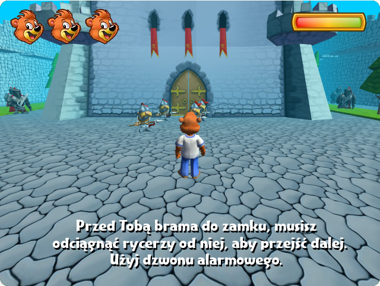
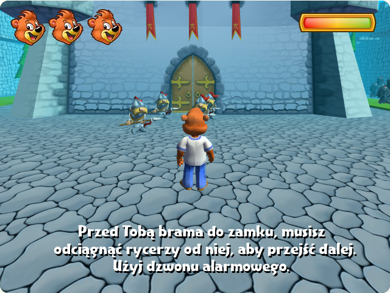
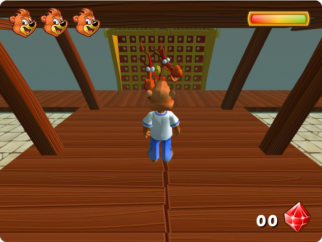
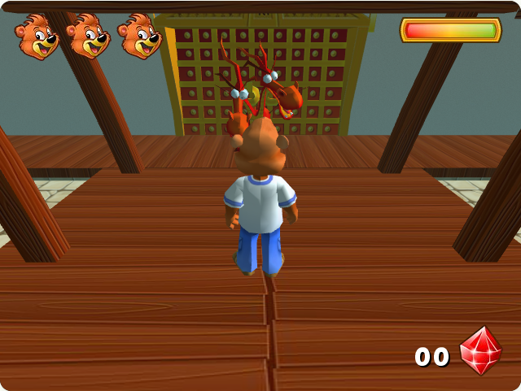
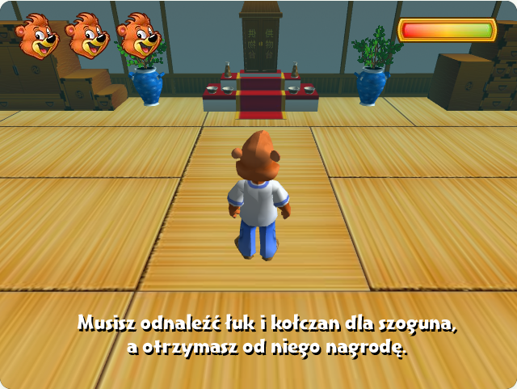
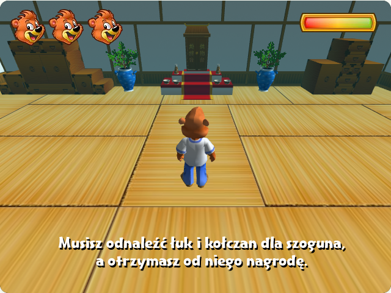
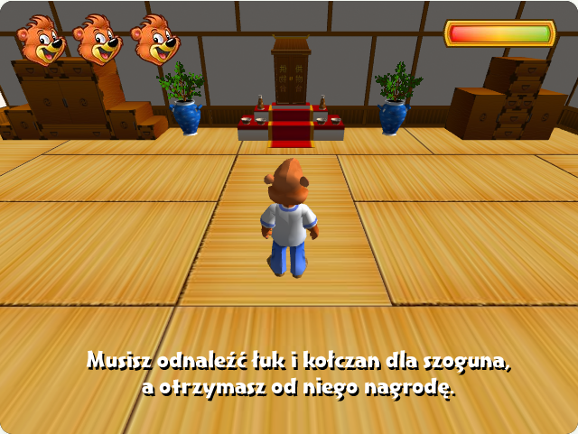

# Porównanie bez zmian w grze

Stan porównania: 22 października 2026. Tylko odczyt kodu i izolowane rendery testowe; bez zmian w poprzednich poziomach gry.

## Co jest potwierdzone

- Poziomy 3, 5 i 6: skrypty oryginału ustawiają pionowe FOV 60°, obecny port 70°. Dokumentacja Directora potwierdza, że chodzi o ten sam rodzaj kąta, którego używa three.js.
- Przy zamrożonej pozycji kamery, jej kierunku, pozycji i animacji postaci przełączenie wyłącznie FOV daje zmianę skali o 21,28%. Jest to różnica projekcji, nie dowód złego dystansu kamery.
- Poziom 6: oryginał ustawia mgłę linear 2700–3000. Port używa exponential2. Poniższa próba zmienia wyłącznie mgłę, bez zmiany FOV ani kamery.

## Czego jeszcze nie potwierdzono

- Nie odtworzono identycznej pozycji i historii kolizji kamery z archiwalnych screenów. Nie ma więc podstaw do podawania jednej poprawnej odległości kamery ani do zmiany jej ruchu.
- Na etapach 1, 2 i 4 FOV 70° odpowiada skryptom. Nie wykazano błędu ich dystansu kamery.
- Moje wcześniejsze stwierdzenie, że mgła 1–5 jest w pełni zgodna, było zbyt szerokie. Dokumentacja podaje, że exponential2 korzysta z near, a far ignoruje. Port wylicza gęstość z far i nie dostaje near=3500. To różnica semantyki ustawień; rzeczywista zgodność krzywej mgły wymaga dalszego sprawdzenia. Nie wprowadzono korekty.
- Różnice jasności ścian i kolorów mogą też pochodzić z oświetlenia, materiałów i sposobu renderowania; ten test ich nie zmienia.

## Pomiar skali (640 × 480)

Wysokość dotyczy projekcji obwiedni animowanej siatki, a nie ręcznego pomiaru konturu pikseli. W każdej parze klatka i transformacje są identyczne.

| Poziom | Obecne 70° | Próba 60° | Zmiana skali |
|---|---:|---:|---:|
| 3 | 120.86 px | 146.57 px | 21.28% |
| 5 | 176.64 px | 214.23 px | 21.28% |
| 6 | 149.25 px | 181.01 px | 21.28% |

## Pary renderów

**Próba 60° to port ze zmienionym w pamięci wyłącznie FOV, nie zrzut uruchomionego oryginału. Nie jest to wdrożona zmiana.**

### Poziom 3: tylko pole widzenia

| Obecny port: 70° | Izolowana próba: 60° |
|---|---|
|  |  |

### Poziom 5: tylko pole widzenia

| Obecny port: 70° | Izolowana próba: 60° |
|---|---|
|  |  |

### Poziom 6: tylko pole widzenia

| Obecny port: 70° | Izolowana próba: 60° |
|---|---|
|  |  |

### Poziom 6: tylko mgła, FOV stale 70°

| Obecny port: exponential2 | Próba: linear 2700–3000 |
|---|---|
|  |  |

## Źródła i odtwarzalność

- Skrypty `inicjalizacja_kamer.ls` z poziomów 1–6, wyciągnięte przez ProjectorRays z plików `pelna_wersja/*.dcr`. Użyto końcowej wartości `camera("druga").fieldOfView`, nie ustawienia kamery pomocniczej.
- [Macromedia Director Scripting Reference](https://eclass.hmu.gr/modules/document/file.php/TP194/drmx2004_scripting_ref.pdf): drukowana strona 763, fieldOfView (3D); drukowana strona 725, decayMode (fog).
- Próby wykonano lokalnym skryptem Playwright w osobnej przeglądarce: zatrzymano pętlę gry, zapisano kadr przy FOV 70°, zmieniono wyłącznie FOV na 60° i wyrenderowano tę samą scenę. W próbie mgły zachowano FOV 70° i podmieniono wyłącznie obiekt mgły w pamięci.
- [Pomiary JSON](porownanie-kamery/pomiary.json): pozycje i kwaterniony kamer, pozycje gracza i pomiary projekcji.
- Pliki gry nie były zmieniane przy wykonywaniu prób. Render z innym parametrem jest wyłącznie materiałem porównawczym.
